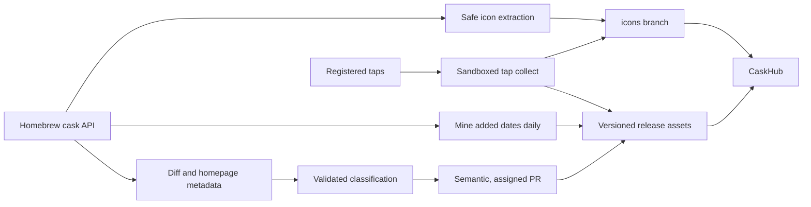

# CaskFlow

<p align="center">
  <a href="https://github.com/alielsokary/CaskFlow/actions/workflows/tests.yml"></a>
  <a href="https://app.codacy.com/gh/alielsokary/CaskFlow/dashboard"></a>
  <a href="https://codecov.io/gh/alielsokary/CaskFlow"></a>
  <a href="LICENSE"></a>
  <a href="https://github.com/alielsokary/CaskFlow/releases/latest"></a>
</p>

<p align="center">
  <sub><a href="README.zh-CN.md">简体中文</a> · <a href="README.md">English</a> · <a href="README.es-ES.md">Español</a></sub>
</p>

<p align="center">
  
</p>

CaskFlow macht aus dem aktuellen Homebrew-Cask-Katalog geprüfte, veröffentlichungsreife Metadaten für [CaskHub](https://github.com/alielsokary/CaskHub). Es klassifiziert Anwendungen, erfasst, wann Casks hinzugefügt wurden, extrahiert Herstellersymbole sicher und veröffentlicht versionierte Assets, die CaskHub mit einem mitgelieferten Fallback nutzen kann.

## Was CaskFlow veröffentlicht

| Asset | Zweck | Quelle |
|---|---|---|
| `categories.json` | Kanonische Zuordnung von Casks zu Kategorien, Taxonomie, Release-Tag und Symbolmanifest | Repository und [neuestes Release](https://github.com/alielsokary/CaskFlow/releases/latest) |
| `tap-categories.json` | Kategorien für Casks aus registrierten Drittanbieter-Taps | Neuestes Release |
| `added_dates.json` | Frühestes bekanntes Homebrew-Hinzufügedatum je Cask | Neuestes Release |
| `app_identities.json` | Von jedem Cask deklarierte Bundle-Identifier zum Erkennen installierter Apps | Neuestes Release |
| `<token>.png` | App-Symbole in 256×256, Tap-Symbole unter `taps/<user>/<repo>/` | Verwaister [`icons`-Branch](https://github.com/alielsokary/CaskFlow/tree/icons) |

Die Taxonomie umfasst 17 Hauptkategorien und ein nur sekundär nutzbares `ai`-Merkmal. Jeder Cask hat genau eine Hauptkategorie und bis zu zwei unterschiedliche Nebenkategorien. Kategoriegrenzen und Prüfregeln stehen im [Klassifizierungsleitfaden](docs/CLASSIFICATION_GUIDE.md).

## Funktionsweise



- **Klassifizierung** läuft täglich, fügt neue Casks hinzu und übernimmt Token-Umbenennungen von Homebrew. Veraltete, deaktivierte oder entfernte Casks behalten ihren Eintrag, damit installierte Kopien ihre Kategorie behalten. Ergebnisse unter `0.75` Konfidenz bleiben in einem zugewiesenen PR zur manuellen Prüfung; Aktualisierungen mit höherer Konfidenz können nach bestandenen Pflichtprüfungen automatisch gemergt werden.
- **Releases** laufen täglich und bei jedem Kategorie-Merge, unabhängig von der Klassifizierung. Jedes Release versieht `categories.json` mit Tag und Symbolmanifest, ermittelt `added_dates.json` aus der Homebrew-Historie und prüft, dass jeder Cask in `homebrew/cask` ein Hinzufügedatum hat.
- **Symbole** werden aus Herstellerartefakten geladen, per Prüfsumme verifiziert, ohne Ausführung von Installationsskripten entpackt und aus der `.icns`-Datei des App-Bundles konvertiert. Siehe [Icon Extraction](docs/ICON_EXTRACTION.md).
- **Drittanbieter-Taps** aus [`taps.json`](taps.json) erhalten Symbole und Kategorien über eine separate wöchentliche Pipeline. Tap-Code wird nur in einer eigenen macOS-Sandbox je Tap gelesen, ohne Netzwerk und ohne Zugangsdaten. Einen Tap anfragen: [Add a tap](https://github.com/alielsokary/CaskFlow/issues/new?template=add-tap.md)-Issue öffnen.
- **House Pick**, das Browse-Highlight in CaskHub, wird von Hand über den Workflow `Set house pick` gewählt. Er prüft den Token, schreibt `data/house_pick.json`, und das folgende Release trägt ihn als `housePick` in `categories.json` ein.
- **Paket-Pilot**, eine manuelle [Installationsbeobachtung](docs/PACKAGE_OBSERVATIONS.md) auf temporären Apple-Silicon- und Intel-Runnern, sichert Belege zur Prüfung und veröffentlicht nichts.

## Lokale Entwicklung

Erfordert Python 3.12 oder neuer.

```bash
python3 -m venv .venv
source .venv/bin/activate
pip install -r requirements.txt

# Deterministic preview; repository files remain unchanged.
LLM_PROVIDER=mock python scripts/classify_new_casks.py --dry-run

# Test suite and coverage report.
pytest --cov=scripts --cov-report=term-missing
```

Die echte Klassifizierung unterstützt `anthropic`, `openai`, `groq` und `cloudflare`; wähle einen Anbieter mit `LLM_PROVIDER` und hinterlege dessen Zugangsdaten.

## Projekte, die CaskFlow nutzen

| Projekt | Beschreibung | Kategorien | Hinzufüge&shy;daten | Symbole |
|---|---|:---:|:---:|:---:|
| [CaskHub](https://github.com/alielsokary/CaskHub) | Native macOS-App zum Entdecken, Installieren und Verwalten von Homebrew-Casks | ✅ | ✅ | ✅ |
| [Applite](https://github.com/milanvarady/Applite) | Benutzerfreundliche macOS-Oberfläche für Homebrew-Casks | - | - | ✅ |
| [Tappie](https://www.empiricapps.com/tappie) | Kostenlose native Homebrew-Oberfläche für macOS, entwickelt mit SwiftUI | - | - | ✅ |
| [*Deins&nbsp;hinzufügen*](https://github.com/alielsokary/CaskFlow/edit/develop/README.md) | Nutzt dein Projekt CaskFlow-Daten? Trag es in diese Tabelle ein | - | - | - |

CaskFlow steht unter der [MIT-Lizenz](LICENSE), eine Namensnennung ist daher nicht erforderlich. Über einen sichtbaren Hinweis mit Link freuen wir uns, zum Beispiel:

> Cask-Metadaten bereitgestellt von [CaskFlow](https://github.com/alielsokary/CaskFlow)

## Mitwirken

Fehlerberichte, Taxonomie-Korrekturen, Tests und Härtung der Pipeline sind willkommen. Lies zuerst [CONTRIBUTING.md](CONTRIBUTING.md) zu lokaler Prüfung, Belegen für Korrekturen und dem semantischen PR-Titelformat. Pull Requests richten sich an `develop`.

## Lizenz

[MIT](LICENSE)
