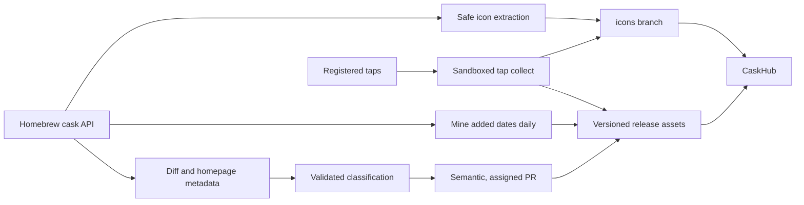

# CaskFlow

<p align="center">
  <a href="https://github.com/alielsokary/CaskFlow/actions/workflows/tests.yml"></a>
  <a href="https://app.codacy.com/gh/alielsokary/CaskFlow/dashboard"></a>
  <a href="https://codecov.io/gh/alielsokary/CaskFlow"></a>
  <a href="LICENSE"></a>
  <a href="https://github.com/alielsokary/CaskFlow/releases/latest"></a>
</p>

<p align="center">
  <sub><a href="README.zh-CN.md">简体中文</a> · <a href="README.de-DE.md">Deutsch</a> · <a href="README.md">English</a></sub>
</p>

<p align="center">
  
</p>

CaskFlow convierte el catálogo activo de casks de Homebrew en metadatos revisados y listos para publicación para [CaskHub](https://github.com/alielsokary/CaskHub). Clasifica aplicaciones, rastrea cuándo se agregaron los casks, extrae iconos de proveedores de forma segura y publica activos versionados que CaskHub puede consumir con una alternativa integrada.

## Qué publica CaskFlow

| Activo | Propósito | Origen |
|---|---|---|
| `categories.json` | Mapeo canónico de cask a categoría, taxonomía, etiqueta de versión y manifiesto de iconos | Repositorio y [última versión](https://github.com/alielsokary/CaskFlow/releases/latest) |
| `tap-categories.json` | Categorías de los casks de taps de terceros registrados | Última versión |
| `added_dates.json` | Fecha de adición más temprana conocida en Homebrew para cada cask | Última versión |
| `app_identities.json` | Identificadores de paquete que declara cada cask, para reconocer apps instaladas | Última versión |
| `<token>.png` | Iconos de aplicaciones de 256×256; los de taps en `taps/<user>/<repo>/` | Rama huérfana [`icons`](https://github.com/alielsokary/CaskFlow/tree/icons) |

La taxonomía cuenta con 17 categorías principales y un rasgo `ai` exclusivo de categoría secundaria. Cada cask tiene exactamente una categoría principal y hasta dos categorías secundarias distintas. Consulta la [guía de clasificación](docs/CLASSIFICATION_GUIDE.md) para conocer los límites de las categorías y las reglas de revisión.

## Cómo funciona



- **Clasificación**: se ejecuta a diario, agrega casks nuevos y migra los cambios de nombre de tokens de Homebrew. Los casks obsoletos, deshabilitados o eliminados conservan su entrada para que las copias instaladas mantengan su categoría. Los resultados con confianza inferior a `0.75` permanecen en una PR asignada para revisión manual; las actualizaciones con mayor confianza pueden fusionarse automáticamente tras superar las comprobaciones obligatorias.
- **Publicaciones**: se ejecutan a diario y con cada fusión de categorías, de forma independiente a la clasificación. Cada publicación marca `categories.json` con su etiqueta y manifiesto de iconos, extrae `added_dates.json` del historial de Homebrew y verifica que cada cask de `homebrew/cask` tenga una fecha de adición.
- **Iconos**: se descargan de los artefactos del proveedor, se verifican con suma de comprobación, se extraen sin ejecutar scripts de instalación y se convierten desde el `.icns` del paquete de la app. Consulta [Extracción de iconos](docs/ICON_EXTRACTION.md).
- **Taps de terceros**: los listados en [`taps.json`](taps.json) obtienen iconos y categorías mediante una canalización semanal separada. El código de cada tap solo se lee dentro de un sandbox de macOS propio, sin red ni credenciales. Para solicitar un tap, abre una incidencia [Add a tap](https://github.com/alielsokary/CaskFlow/issues/new?template=add-tap.md).
- **Selección de la casa**: el destacado de Explorar en CaskHub se elige a mano con el flujo `Set house pick`. Valida el token, escribe `data/house_pick.json` y la publicación resultante lo añade a `categories.json` como `housePick`.
- **Piloto de paquetes**: una [observación de instalación](docs/PACKAGE_OBSERVATIONS.md) manual en runners desechables Apple Silicon e Intel que guarda evidencias para revisión y no publica nada.

## Desarrollo local

Requiere Python 3.12 o posterior.

```bash
python3 -m venv .venv
source .venv/bin/activate
pip install -r requirements.txt

# Deterministic preview; repository files remain unchanged.
LLM_PROVIDER=mock python scripts/classify_new_casks.py --dry-run

# Test suite and coverage report.
pytest --cov=scripts --cov-report=term-missing
```

La clasificación real admite `anthropic`, `openai`, `groq` y `cloudflare`; elige uno con `LLM_PROVIDER` y proporciona las credenciales de ese servicio.

## Proyectos que usan CaskFlow

| Proyecto | Descripción | Categorías | Fechas&nbsp;de&nbsp;adición | Iconos |
|---|---|:---:|:---:|:---:|
| [CaskHub](https://github.com/alielsokary/CaskHub) | Aplicación nativa para macOS para descubrir, instalar y administrar casks de Homebrew | ✅ | ✅ | ✅ |
| [Applite](https://github.com/milanvarady/Applite) | Aplicación macOS con interfaz gráfica y fácil de usar para casks de Homebrew | - | - | ✅ |
| [Tappie](https://www.empiricapps.com/tappie) | Interfaz gráfica nativa y gratuita de Homebrew para macOS, creada con SwiftUI | - | - | ✅ |
| [*Añade&nbsp;el&nbsp;tuyo*](https://github.com/alielsokary/CaskFlow/edit/develop/README.md) | ¿Usas datos de CaskFlow en tu proyecto? Añádelo a esta tabla | - | - | - |

CaskFlow tiene [licencia MIT](LICENSE), por lo que no se requiere atribución. Se agradece un crédito visible con un enlace de vuelta, por ejemplo:

> Metadatos de casks impulsados por [CaskFlow](https://github.com/alielsokary/CaskFlow)

## Contribución

Son bienvenidos los informes de errores, correcciones taxonómicas, pruebas y el endurecimiento de la canalización. Comienza con [CONTRIBUTING.md](CONTRIBUTING.md) para la verificación local, la evidencia de correcciones y el formato de título semántico de las PR. Los pull requests se dirigen a `develop`.

## Licencia

[MIT](LICENSE)
