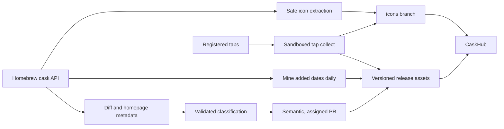

# CaskFlow

<p align="center">
  <a href="https://github.com/alielsokary/CaskFlow/actions/workflows/tests.yml"></a>
  <a href="https://app.codacy.com/gh/alielsokary/CaskFlow/dashboard"></a>
  <a href="https://codecov.io/gh/alielsokary/CaskFlow"></a>
  <a href="https://github.com/alielsokary/CaskFlow/releases/latest"></a>
  <a href="LICENSE"></a>
</p>

<p align="center">
  <sub><strong>English</strong> · <a href="README.zh-CN.md">简体中文</a> · <a href="README.es-ES.md">Español</a> · <a href="README.de-DE.md">Deutsch</a></sub>
</p>

<p align="center">
  
</p>

CaskFlow turns the live Homebrew cask catalog into reviewed, release-ready metadata for [CaskHub](https://github.com/alielsokary/CaskHub). It classifies applications, tracks when casks were added, extracts vendor icons safely, and publishes versioned assets that CaskHub can consume with a bundled fallback.

## What CaskFlow publishes

| Asset | Purpose | Source |
|---|---|---|
| `categories.json` | Canonical cask-to-category mapping, taxonomy, release tag, and icon manifest | Repository and [latest release](https://github.com/alielsokary/CaskFlow/releases/latest) |
| `tap-categories.json` | Categories for casks in registered third-party taps | Latest release |
| `added_dates.json` | Earliest known Homebrew addition date for each cask | Latest release |
| `app_identities.json` | Bundle identifiers each cask declares, for matching installed apps | Latest release |
| `<token>.png` | 256×256 application icons, tap icons under `taps/<user>/<repo>/` | Orphan [`icons` branch](https://github.com/alielsokary/CaskFlow/tree/icons) |

The taxonomy has 17 primary categories and one secondary-only `ai` trait. Each cask has exactly one primary category and up to two distinct secondary categories. See the [classification guide](docs/CLASSIFICATION_GUIDE.md) for category boundaries and review rules.

## How it works



- **Classification** runs daily, adds new casks, and migrates Homebrew token renames. Deprecated, disabled, or removed casks keep their entries so installed copies keep their category. Results below `0.75` confidence stay in an assigned PR for manual review; higher-confidence updates may auto-merge after required checks pass.
- **Releases** run daily and on every category merge, independent of classification. Each release stamps `categories.json` with its tag and icon manifest, mines `added_dates.json` from Homebrew's history, and verifies every cask in `homebrew/cask` has an added date.
- **Icons** are downloaded from vendor artifacts, checksum-verified, expanded without running installer scripts, and converted from the app bundle's `.icns`. See [Icon Extraction](docs/ICON_EXTRACTION.md).
- **Third-party taps** listed in [`taps.json`](taps.json) get icons and categories from a separate weekly pipeline. Tap code is read only inside a per-tap macOS sandbox with no network or credentials. To request a tap, open an [Add a tap](https://github.com/alielsokary/CaskFlow/issues/new?template=add-tap.md) issue.
- **House pick**, CaskHub's Browse hero, is chosen by hand with the `Set house pick` workflow. It validates the token, writes `data/house_pick.json`, and the resulting release stamps it into `categories.json` as `housePick`.
- **Package pilot**, a manual [installation observation](docs/PACKAGE_OBSERVATIONS.md) on disposable Apple Silicon and Intel runners, saves evidence for review and publishes nothing.

## Local development

Requires Python 3.12 or newer.

```bash
python3 -m venv .venv
source .venv/bin/activate
pip install -r requirements.txt

# Deterministic preview; repository files remain unchanged.
LLM_PROVIDER=mock python scripts/classify_new_casks.py --dry-run

# Test suite and coverage report.
pytest --cov=scripts --cov-report=term-missing
```

Real classification supports `anthropic`, `openai`, `groq`, and `cloudflare`; choose one with `LLM_PROVIDER` and provide that service's credentials.

## Projects using CaskFlow

| Project | Description | Categories | Added&nbsp;Dates | Icons |
|---|---|:---:|:---:|:---:|
| [CaskHub](https://github.com/alielsokary/CaskHub) | Native macOS app for discovering, installing, and managing Homebrew casks | ✅ | ✅ | ✅ |
| [Applite](https://github.com/milanvarady/Applite) | User-friendly GUI macOS application for Homebrew casks | - | - | ✅ |
| [*Add&nbsp;yours*](https://github.com/alielsokary/CaskFlow/edit/develop/README.md) | Using CaskFlow data in your project? Add it to this table | - | - | - |

CaskFlow is [MIT licensed](LICENSE), so no attribution is required. A visible credit with a link back is appreciated, for example:

> Cask metadata powered by [CaskFlow](https://github.com/alielsokary/CaskFlow)

## Contributing

Bug reports, taxonomy corrections, tests, and pipeline hardening are welcome. Start with [CONTRIBUTING.md](CONTRIBUTING.md) for local verification, correction evidence, and the semantic PR title format. Pull requests target `develop`.

## License

[MIT](LICENSE)
