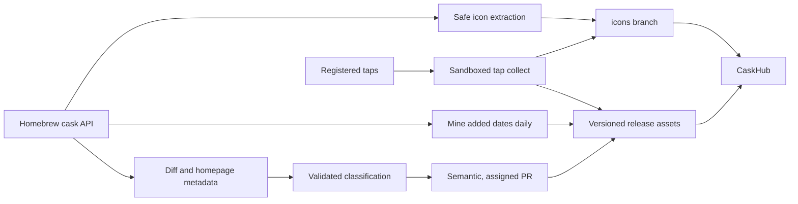

# CaskFlow

<p align="center">
  <a href="https://github.com/alielsokary/CaskFlow/actions/workflows/tests.yml"></a>
  <a href="https://app.codacy.com/gh/alielsokary/CaskFlow/dashboard"></a>
  <a href="https://codecov.io/gh/alielsokary/CaskFlow"></a>
  <a href="LICENSE"></a>
  <a href="https://github.com/alielsokary/CaskFlow/releases/latest"></a>
</p>

<p align="center">
  <sub><a href="README.de-DE.md">Deutsch</a> · <a href="README.md">English</a> · <a href="README.es-ES.md">Español</a></sub>
</p>

<p align="center">
  
</p>

CaskFlow 将实时的 Homebrew cask 目录转换为经过审核、可直接发布的 [CaskHub](https://github.com/alielsokary/CaskHub) 元数据。它为应用分类、记录 cask 的添加时间、安全提取厂商图标，并发布带版本号的资源，供 CaskHub 使用，同时内置后备数据。

## CaskFlow 发布的内容

| 资源 | 用途 | 来源 |
|---|---|---|
| `categories.json` | 规范的 cask 分类映射、分类体系、发布标签和图标清单 | 仓库及[最新发布](https://github.com/alielsokary/CaskFlow/releases/latest) |
| `tap-categories.json` | 已登记第三方 tap 中 cask 的分类 | 最新发布 |
| `added_dates.json` | 每个 cask 已知最早加入 Homebrew 的日期 | 最新发布 |
| `app_identities.json` | 每个 cask 声明的 Bundle ID，用于识别已安装的应用 | 最新发布 |
| `<token>.png` | 256×256 应用图标，tap 图标位于 `taps/<user>/<repo>/` | 孤立的 [`icons` 分支](https://github.com/alielsokary/CaskFlow/tree/icons) |

分类体系包含 17 个主分类和一个仅可作为次分类的 `ai` 标记。每个 cask 恰好有一个主分类，最多有两个不同的次分类。分类边界和审核规则见[分类指南](docs/CLASSIFICATION_GUIDE.md)。

## 工作原理



- **分类**每天运行，添加新的 cask 并迁移 Homebrew 的 token 重命名。已弃用、已禁用或已移除的 cask 会保留条目，使已安装的副本保持其分类。置信度低于 `0.75` 的结果留在已指派的 PR 中人工审核；置信度更高的更新在必需检查通过后可自动合并。
- **发布**每天运行，并在每次分类合并时触发，与分类流程相互独立。每次发布都会为 `categories.json` 写入标签和图标清单，从 Homebrew 历史中挖掘 `added_dates.json`，并确认 `homebrew/cask` 中每个 cask 都有添加日期。
- **图标**从厂商制品下载，经校验和验证，在不运行安装脚本的情况下解包，并从应用包的 `.icns` 文件转换。详见 [Icon Extraction](docs/ICON_EXTRACTION.md)。
- **第三方 tap**：[`taps.json`](taps.json) 中登记的 tap 通过独立的每周流水线获得图标和分类。tap 代码只在每个 tap 专属的 macOS 沙盒中读取，无网络、无凭据。如需添加 tap，请提交 [Add a tap](https://github.com/alielsokary/CaskFlow/issues/new?template=add-tap.md) issue。
- **House Pick**，即 CaskHub 浏览页的首推应用，通过 `Set house pick` 工作流手动选定。它会校验 token、写入 `data/house_pick.json`，随后的发布会将其以 `housePick` 写入 `categories.json`。
- **安装包试点**是在一次性 Apple Silicon 和 Intel runner 上手动进行的[安装观察](docs/PACKAGE_OBSERVATIONS.md)，只保存供审核的证据，不发布任何内容。

## 本地开发

需要 Python 3.12 或更高版本。

```bash
python3 -m venv .venv
source .venv/bin/activate
pip install -r requirements.txt

# Deterministic preview; repository files remain unchanged.
LLM_PROVIDER=mock python scripts/classify_new_casks.py --dry-run

# Test suite and coverage report.
pytest --cov=scripts --cov-report=term-missing
```

实际分类支持 `anthropic`、`openai`、`groq` 和 `cloudflare`；通过 `LLM_PROVIDER` 选择其一，并提供该服务的凭据。

## 使用 CaskFlow 的项目

| 项目 | 描述 | 分类 | 添加日期 | 图标 |
|---|---|:---:|:---:|:---:|
| [CaskHub](https://github.com/alielsokary/CaskHub) | 用于发现、安装和管理 Homebrew cask 的原生 macOS 应用 | ✅ | ✅ | ✅ |
| [Applite](https://github.com/milanvarady/Applite) | 易用的 Homebrew cask 图形界面 macOS 应用 | - | - | ✅ |
| [Tappie](https://www.empiricapps.com/tappie) | 免费的原生 Homebrew 图形界面 macOS 应用，使用 SwiftUI 构建 | - | - | ✅ |
| [*添加你的项目*](https://github.com/alielsokary/CaskFlow/edit/develop/README.md) | 你的项目在使用 CaskFlow 数据？将它加入此表 | - | - | - |

CaskFlow 采用 [MIT 许可证](LICENSE)，无需署名。若能在显眼处注明并附上链接，我们将十分感谢，例如：

> Cask 元数据由 [CaskFlow](https://github.com/alielsokary/CaskFlow) 提供

## 参与贡献

欢迎提交错误报告、分类修正、测试以及流水线加固。请先阅读 [CONTRIBUTING.md](CONTRIBUTING.md)，了解本地验证、修正依据和语义化 PR 标题格式。Pull request 请提交到 `develop` 分支。

## 许可证

[MIT](LICENSE)
